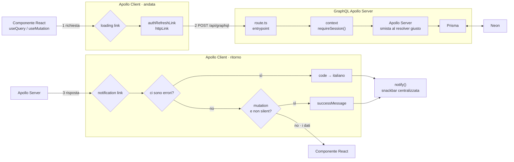
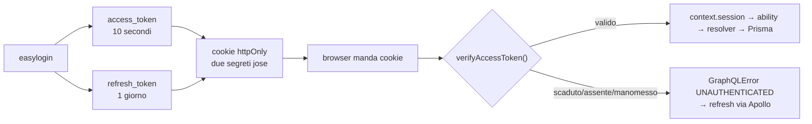
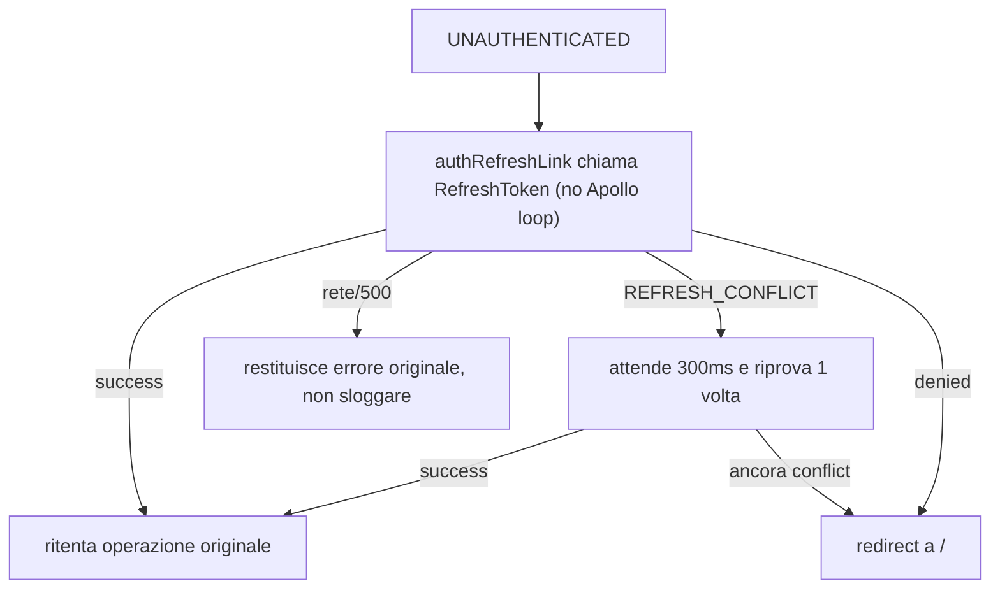
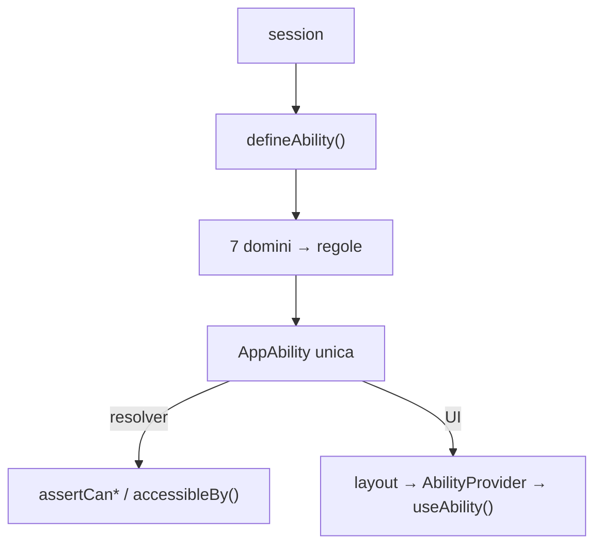
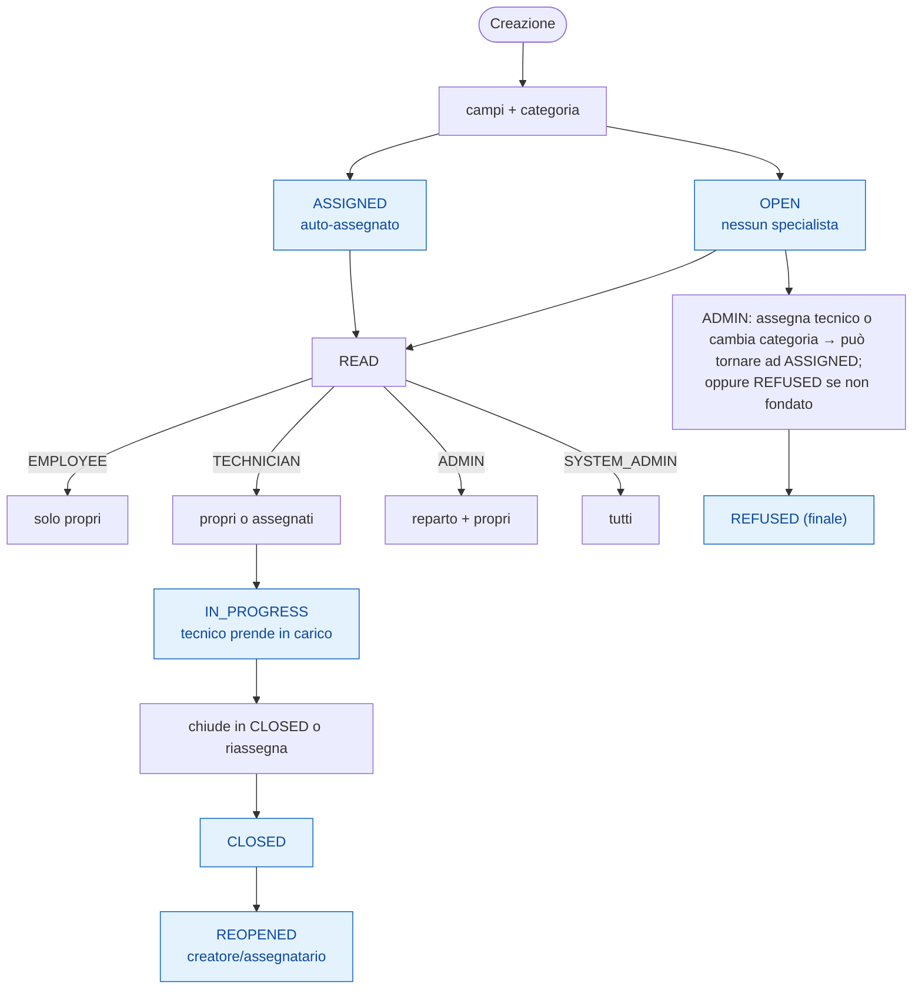

# Helpdesk

Gestione delle richieste di assistenza interna. Gli utenti aprono ticket, i tecnici
li prendono in carico, e ogni ticket attraversa un ciclo di stati fino alla chiusura
o al rifiuto. Ognuno vede solo quello che gli compete, in base al ruolo e al
reparto.

## Funzionalità

- **Ticket** con titolo, descrizione, priorità, scadenza e stato, più i campi
  specifici del reparto (IT, HR, Finance, Support, Logistic).
- **Assegnazione automatica**: il backend sceglie il tecnico specializzato nella
  categoria che ha meno ticket aperti, escludendo chi ha aperto il ticket quando
  esiste un altro candidato.
- **Permessi con CASL**: quattro ruoli (`EMPLOYEE`, `TECHNICIAN`, `ADMIN`,
  `SYSTEM_ADMIN`) e un unico set di regole che vale sia per la UI sia per il server.
- **Categorie con matrice di accesso**: ogni categoria dichiara quali ruoli e
  reparti possono usarla, quindi la dashboard di un utente cambia in base a chi è.
- **Messaggi e history** su ogni ticket, con tracciamento di chi ha fatto cosa.
- **Notifiche in app**, con subscription per gli amministratori.
- **Statistiche** per reparto.
- **Autenticazione** con access token e refresh token.

## Struttura

```
app/            pagine, route group protetti e route handler GraphQL
components/     componenti React, quasi tutti presentational
apollo-client/  cache, link e query/mutation
graphql/        schema, resolver e moduli di dominio
lib/            logica di dominio, permessi CASL, validazione
prisma/         schema e seed
```

Il client Prisma non si genera in `node_modules` ma in `app/generated/prisma`,
perciò va rigenerato insieme allo schema.

## Avvio

```bash
npm install
npx prisma migrate dev   # crea lo schema sul database
npx prisma generate      # genera il client
npm run codegen          # genera i tipi GraphQL
npm run dev
```

Servono le variabili d'ambiente per la connessione al database e per i segreti
dell'autenticazione.

## Panoramica tecnica (breve)

### Stack

- **[Next.js](https://nextjs.org/docs)** (App Router) — Struttura full-stack con route handler per GraphQL e layout protetti.
- **[React](https://react.dev/)** + **[TypeScript](https://www.typescriptlang.org/docs/)** — Componenti e tipizzazione end-to-end.
- **[Material UI (MUI)](https://mui.com/)** — Layout e componenti UI, senza Tailwind.
- **[Apollo Client](https://www.apollographql.com/docs/react/)** — Gestione GraphQL e stato server sul frontend.
- **[React Hook Form](https://react-hook-form.com/)** + **[Zod](https://zod.dev/)** — Form e validazione condivisa con backend.
- **[GraphQL](https://graphql.org/learn/)** — Contratto tra frontend e backend.
- **[Prisma](https://www.prisma.io/docs)** + **[Neon](https://neon.tech/docs/introduction)** — ORM e database PostgreSQL.
- **[CASL](https://casl.js.org/v6/en/)** — Permessi basati su regole, riutilizzati frontend/backend.
- **[jose](https://github.com/panva/jose)** — Firma e verifica JWT (access + refresh). 

### GraphQL + Apollo Client

I componenti (`useQuery`/`useMutation`) non conoscono la rete: l'andata passa da **loadingLink** (alza il contatore globale per lo spinner), poi da **authRefreshLink** + **httpLink** verso `POST /api/graphql`. Il ritorno passa da **notificationLink** che traduce gli errori in italiano, mostra eventuale messaggio di successo per le mutation e fa proseguire i dati.



**Note**: `loadingVar` gestisce il loader globale; `notificationLink` centralizza errori/success (nessun `try/catch` + `notify` nei componenti). 

### Autenticazione

Easylogin a credenziali preimpostate. Vengono emessi due JWT (**access** e **refresh**) con **segreti separati** e scritti in **cookie httpOnly** (`secure` solo in produzione, `sameSite: "lax"`). Il context verifica l'access token una volta sola; se scaduto/manomesso, **authRefreshLink** (Apollo) reagisce a `UNAUTHENTICATED` chiamando `RefreshToken`.

- Access: 10s, payload contiene `userId`, `role`, `department` (evita query DB ad ogni richiesta).
- Refresh: 1 giorno, payload solo `userId`, salvato in tabella `RefreshToken` con stessa scadenza e `jti` univoco (rotazione + lock per evitare doppie rotazioni).
- Esclusi dal ciclo di refresh: `RefreshToken`, `Login`, `Register`.
- `REFRESH_CONFLICT`: token valido ma riga già ruotata — non sloggare; si ritenta con i nuovi cookie del vincitore.
- `logout`: cancella **tutte** le sessioni dell'utente.

#### Flusso normale



#### Flusso refresh (Apollo authRefreshLink)



[Approfondimento: Autenticazione](AGENTS.md#authentication) e codice in `graphql/context.ts`, `lib/auth/*`, `lib/apollo-client/auth-refresh-link.ts`.

### Permessi (CASL)

È un'unica **AppAbility** costruita da `defineAbility(session)`: ogni dominio (`ticket`, `user`, `category`, `ticket-notification`, `stats`, `ticket-history`, `ticket-scope`) dichiara proprie regole e subject; tutte vengono unite in un solo oggetto. 

- **Backend**: enforcement tramite `assertCan*` (`guards.ts`) o filtro con `accessibleBy()` per le liste (evita fetch+scarto). 
- **Frontend**: le stesse regole serializzate vengono ricostruite in `AbilityProvider` e usate dagli hook di dominio solo per guidare UI (nascondere/disabilitare). La sicurezza resta sul backend.



[CASL docs](https://casl.js.org/v6/en/guide/intro), implementazione in `lib/casl/defineAbility.ts` e `lib/casl/abilityContext.tsx`.

### Ciclo di vita del Ticket

Il backend decide l'assegnazione in creazione: se esiste un tecnico specialista nella categoria con meno ticket aperti → **ASSIGNED** (auto-assegnato), altrimenti **OPEN** (da assegnare). Lettura/modifica/cancellazione dipendono da **ruolo** + relazione (creatore/assegnatario) + **reparto**. Le transizioni di stato sono in `ALLOWED_STATUS_TRANSITIONS` (mappa), separate dai permessi CASL.



Dettagli campo-per-campo: vedere `lib/casl/abilities/ticket/rules.ts`.

### Errori, notifiche e loading

- **Backend**: `GraphQLError` con **messaggio inglese** (dev/log) + `extensions.code` in `UPPER_SNAKE_CASE`. Mai testo italiano nel backend.
- **Frontend (`notificationLink`)**: mappa `extensions.code` → **messaggio italiano** (`graphqlErrorMessages`), fallback a messaggio originale o generico. Anche errori HTTP mappati. 
- **Success**: per mutation, se non `silent`, mostra `context.successMessage` (con placeholder sostituiti dai campi ritornati). 
- **Side effects**: `FORBIDDEN`/403 → `redirectToDashboard()`; `UNAUTHENTICATED` gestito da `authRefreshLink` (refresh + retry, redirect a `/` solo se fallisce).
- **Loading**: `loadingLink` incrementa/decrementa `loadingVar` (contatore globale). Il loader globale legge `loadingVar`; il `loading` locale Apollo resta per disabilitare singoli bottoni.
